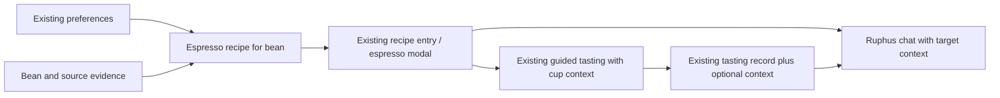

# Barista Express Espresso - Plan

## Goal Capsule

**Objective:** Rob can get, refine through Ruphus chat, and reuse an espresso recipe for his coffee, then save a guided tasting with the recipe and equipment used.

**Means:** Extend the existing bean → recipe → chat / guided tasting experience (R1–R7).

**Authority:** Tal's latest instructions govern this plan. The mockup is a proposal, not an approved design. Production implementation must wait for Tal's review and explicit go-ahead. The current authorization covers source research using Hoffmann and Breville, plan updates, an isolated mockup revision, and the earlier competitor inspection; production implementation remains unapproved.

**Execution:** After approval, implement in dependency order; preserve existing user work. The owning implementation chat finishes verification. Deployment requires separate release authority. Stop for a scope change, machine mismatch, or a conflict with concurrent chat work.

---

## Product Contract

### Summary and problem frame

Rob owns a Breville Barista Express and wants to use the app. The app supports bean scanning, collection, recipes, chat and guided tasting, but espresso is absent from the real brew-method registry. An espresso onboarding goal already exists. A compact extension should make the existing experience useful for him without introducing a second product around shot tracking.

### Key decisions

- **Keep the existing experience.** (session-settled: user-directed — chosen over a dedicated dial-in/shot-log workflow because it adds too much functionality.) Governs R1, R3, R6, R7.
- **Recipes plus knowledgeable Ruphus.** (session-settled: user-directed — chosen over equipment integrations and structured troubleshooting forms.) Governs R2, R4, R5.
- **Keep the better recipe through chat.** (session-settled: user-directed, October 12 follow-up.) Ruphus can apply requested recipe edits with a visible result and Undo; no separate shot journal. Machine and grinder are independent choices. Governs R1, R4, R7, R9.
- **Review a mockup before building.** (session-settled: user-directed.) Governs R8.

### Requirements

#### Equipment and recipes

R1. Add Espresso and a Barista Express equipment preset to existing preferences/onboarding. Store machine, grinder and basket independently. Offer built-in or external grinder, including a custom model when absent from the catalog. Keep Espresso generic in the data model; Barista Express is the first verified machine preset. Retain other methods and their grinder preferences. Changing grinder invalidates grinder-specific guidance without converting dial numbers between grinders.

R2. Generate a bean-specific espresso starting recipe: coffee dose in grams, beverage yield in grams, ratio, approximate extraction-time range with an explicit timing convention, grind starting guidance, and concise preparation instructions. Distinguish the app's baseline from a verified roaster recipe. Never label espresso output as water input.

R3. Open that recipe from the same bean actions used today. Reuse the modal styling, parameter cards, loading/error/retry behavior and dose-control idiom. Provide familiar routes to chat and guided tasting. No shot timer, log, new tab or dial-in dashboard.

#### Ruphus chat

R4. Ruphus chat receives the selected bean, actual equipment, current espresso recipe, and relevant tasting context. It distinguishes targets from measurements, asks for missing information only when useful, and gives one proportionate next adjustment. It must not assume a saved recipe was brewed. Users can supply dose/yield/time conversationally without a required measurement form.

Prior tasting evidence must be identified by bean, method, equipment and drink context. If a past cup used another setup or recipe revision, explain that distinction rather than treating it as a controlled comparison. Preserve volunteered measurements as reported observations with their cup context; do not fill missing measurements from recipe targets. Keep roaster notes, app expectations and the user's own sensory observations distinct.

R5. Espresso advice is grounded in BES870 guidance and espresso extraction principles. No Ode-to-Breville micron conversion, invented calibrated grinder setting, automated machine control, or unconditional sour=finer/bitter=coarser diagnosis. Advice accounts for basket, preparation, flow and drink context when known.

#### Guided tasting and review

R6. Adapt the existing eight-step guided tasting, deterministic cues, expectations, and optional AI reactions to espresso. Keep the same sensory controls and saved tasting structure. Add a compact straight / with milk choice to the existing intro; do not add a new setup wizard. No crust-breaking or four-minute cupping instructions for espresso.

R7. Preserve cup context through tasting drafts, saves and subsequent chat, including machine, grinder, basket, drink type and a snapshot of the recipe used. Recipe edits must not rewrite old tastings. Recipe entry supplies it; direct Tasting entry defaults to the user's method with a compact correction control. Legacy tastings retain unknown context. Reusing a recipe starts a new tasting with empty observations; never copy a prior rating, notes or measured time into a new cup. Keep the existing saved sensory answers, scores and personal notes. Milk sweetness/body must not be presented as a pure bean signal.

R8. Supply a clickable isolated mockup and this plan for review. No application implementation, live model calls, Firebase writes, builds, deployment or machine interaction occurs as part of this planning deliverable.

R9. Let users edit their saved espresso recipe directly and through Ruphus chat. Advice or hypothetical questions do not mutate it. An explicit instruction such as “save that grind setting” applies a validated update to the correct bean/setup and reports the actual saved result with View recipe and Undo. Ambiguous bean/setup/change requires clarification. Failed saves do not claim success. Preserve user adjustments through reopening and recipe regeneration; make reset/regeneration replacement explicit. This is an in-app recipe update, never machine control.

### Proposed first-release boundary

Verify the standard BES870 Barista Express preset and a stock 2-cup single-wall basket with freshly ground beans first. Support either its built-in grinder or a separately selected external grinder. Only supply numeric grinder advice where model-specific evidence or the user's own setting supports it; otherwise give relative guidance. Other machines can be identified for chat and generic espresso context, but do not inherit Breville basket limits, dial settings or control instructions. Broad verified machine presets remain deferred. Show that assumption clearly; it is a proposed narrow equipment boundary, not a fact established about Rob's basket. An “I'm using a different basket” option explains the limitation and routes to chat without applying the single-wall recipe to unsupported equipment. Do not silently select compatible equipment on Rob's behalf.

No shot history, automatic best-shot ranking, milk recipe generator, maintenance workflow, Bluetooth, espresso freshness algorithm, broad machine catalog, new subscription tier, or redesign. Existing tasting notes and ratings remain the record. A scale helps use a weight-based recipe, but owning one is not an onboarding requirement; Ruphus can explain the limitation without fabricating weights.

### Mockup review

Deliverable: `docs/mockups/2026-10-12-espresso/screens/index.html` and its local `preview.js`. **Research revision ready for review:** sample light/medium/dark starting recipes with source disclosure; separate external grinder selection; direct editing; scripted near-balanced yield refinement; requested chat save, failure/retry and Undo; existing eight-step tasting with saved observations and recipe/setup snapshots. Local browser storage demonstrates reopening; it is not backend proof. Review density, baseline curation, setup assumptions and advice → save behavior. Design approval remains pending. The prototype simplifies the existing tasting fingerprint/reveal and method correction; production must retain those existing capabilities under R6–R7.

Follow-up [market and Mobbin review](../research/2026-10-12-espresso-market-and-design-review.md) supports retaining this small scope. Competitors offer espresso timers, logging and AI coaching; this plan intentionally serves the existing bean → recipe → chat/tasting experience. An elapsed-time stopwatch could be considered later, but the pour-over timed-step workflow and any stopwatch remain outside R3. Research covered official product descriptions and adjacent Mobbin cooking screens, not hands-on competitor testing.

---

## Planning Contract

### Current implementation evidence

- `src/lib/brewMethods.js`: six supported methods; `isManualBrewMethod` currently treats every non-Aiden method as manual. `BREW_DEVICES` also derives from every non-Aiden entry. Adding espresso to the registry alone would leak it into pour-over handling.
- `src/hooks/useHandBrew.js`, `src/tabs/ChatTab.jsx`, `src/components/BeanCard.jsx` and the bean tabs route through Aiden-versus-manual assumptions. Audit call sites before adding the third branch.
- `src/components/HandBrewModal.jsx`: useful presentation patterns, but its data contract concerns water, pours, iced transformations, dose scaling and timers. Reuse its visual idioms, not those assumptions.
- `src/components/onboarding/screens/R07Preferences.jsx`, `src/components/SettingsPage.jsx`, `src/hooks/useUserProfile.jsx`: setup and persistence. `R02Goal.jsx` and `R13Paywall.jsx` already mention espresso.
- `src/tabs/ChatTab.jsx` currently calls `buildChatContext` from `src/lib/claude.js`. Its method whitelist and context branch exclude espresso. Untracked `api/_lib/ruphus*` files and a `api/ruphus-agent.js` coexist in the checkout; do not assume that new path is active or overwrite that work.
- `src/tabs/TastingTab.jsx` uses `TastingWizard`, not the old chat takeover. `buildTastingSystemPrompt` is therefore not sufficient to implement this feature.
- `src/lib/tastingWizardSteps.js` has cupping instructions; `tastingExpectations.js` predicts from bean traits without brew/drink context. `reactToTastingStep` receives bean, step, observation and expectations, but no machine/recipe/drink context.
- `src/App.jsx` owns the in-session wizard draft and bean-ID handoff; extend that handoff with cup context instead of inferring it later from mutable preferences.
- `docs/solutions/logic-errors/grind-size-display-toggle-unwired.md`: shared equipment labels and their consumers must be wired together, not merely added to settings.

### Technical decisions

**Competitor logic grounding (October 12 deep dive):** [Beanconqueror investigation](../research/espresso-app-inspection-2026-10-12/BEANCONQUEROR-LOGIC-DEEP-DIVE.md) traced its bean model, pour-over/espresso defaults, repeat rules, manual best-brew flag, tasting writes, AI label import and calculations. No taste-to-recipe adjustment engine was found in those paths. Its cupping model cites Sweet Maria's spider graphs, not a Hoffmann recipe engine. Our recipe knowledge and Ruphus diagnosis therefore need their own source grounding; competitor code is not that evidence. Borrow separate equipment, context-preserving reuse and input/output semantics. Do not import repeated ratings/notes, cupping-score conversions, fixed extraction-chart quality claims or the frozen-bean 90:1 age heuristic. Broader pour-over improvements remain research recommendations outside this release's requirements.

KTD1. Add a distinct espresso category and explicit routing at existing brew entry points. Keep `isManualBrewMethod` and `BREW_DEVICES` limited to their current manual-method category. Use a small `EspressoModal` and `useEspressoBrew` flow, following existing patterns, without generalizing every recipe engine.

KTD2. Store `espressoRecipe` separately on the bean so it can coexist with Aiden/manual recipes. Include machine, basket, grinder, dose, yield, ratio, time range/basis, source provenance, schema/rules version, recipe revision, user-adjusted fields and a fingerprint of relevant bean/source inputs. Keep original guidance distinguishable from user-saved settings. Reuse the app's authenticated recipe proxy and bean research. Validate numeric output and hardware constraints before saving. Use a labeled baseline when bean evidence is insufficient; a request failure with no valid cached recipe gets a retry state, not invented output.

KTD3. The recipe is an editable target, not a measurement. Dose changes stay within supported basket bounds, update beverage yield consistently, and invalidate the previous recipe context. Cancel/ignore stale generation responses; only the current bean/setup request may render or save. No unbounded pour-over batch scaling.

KTD4. Introduce one compact brew-context resolver/formatter used by chat and tasting. Resolve explicit cup/recipe context before user defaults. Snapshot optional context on new tasting records and drafts; never backfill historical records by guessing. Validate/sanitize free text as existing prompts do. Do not let AI failure block the deterministic tasting path.

KTD5. Preserve the eight tasting steps, field names, score scale and charts. Espresso gets method-appropriate wording and qualitative bean expectations. For espresso, suppress uncalibrated numeric expected markers/comparison claims; the user's own sensory scores still drive the fingerprint. With milk, label the result as the drink and exclude it from bean-only preference inference/comparisons, while keeping the entry in history. This avoids inventing espresso/milk numeric calibration in v1.

KTD6. Implement a narrowly scoped recipe update action in the active chat tool path. Use the same validation and persistence operation for manual edits and chat edits. Resolve the authenticated owner, bean and equipment; allowlist editable fields; validate bounds and ratio consistency; use expected revision and idempotency to prevent stale or repeated writes. Persist first, then return a success receipt and changed fields. Undo restores the prior revision only if no newer edit has superseded it. Recipe targets remain distinct from volunteered observations. No general-purpose agent database writer or shot-history UI.

### Interaction and accessibility

Reuse the existing modal focus/close behavior, sticky actions and responsive widths. Keep dose controls and primary actions at least 44 px touch targets in the app, label controls for assistive technology, and honor reduced motion. Loading retains the bean/setup heading; error offers Retry and Close. Disabled dose bounds remain visible. Exit/resume tasting follows the existing draft-confirmation behavior; the preview simplifies this for inspection.

### Data flow

### Assumptions and constraints

#### Espresso knowledge readiness — source review completed, implementation evaluation pending

The [espresso research foundation](../research/espresso-recipe-foundation-2026-10-12/README.md) is the source-to-rule specification for U2–U4. The October 12 review read original English captions for Hoffmann's Dose, Ratio, Time, Grind and Temperature videos and relevant English BES870 US/Canada X26 manual pages, with diagram checks. The source ledger supplies timestamps, printed pages and retrieval receipts. Local `world-atlas-coffee.md` remains secondary structured notes without verified edition/page attribution.

Adopt rules **E01–E12** and the research evaluation matrix. This establishes a researched proposal, not machine-tested cup quality. Key resolutions:

- Replace the shared `src/lib/coffeeKnowledge.js` 27–29-second / always-grind-first shorthand in U3. H3 supports a 25–30-second beginner guide measured from start to stop; good taste outside that range remains valid. Near a balanced result, H2/H4 support small yield refinements.
- Baseline curation: medium/unknown roast 18→36 g (1:2); explicitly light 17→37.4 g (1:2.2); explicitly dark 18→32.4 g (1:1.8). These exact complete recipes are app synthesis, not Hoffmann/Breville/roaster prescriptions. Unknown roast stays labeled unknown. Do not derive exact recipes from origin, processing or decaf alone.
- Verified compatible roaster espresso evidence can determine an initial recipe. Retain source provenance and label adaptations. User-saved targets take priority over regeneration; hardware incompatibility is surfaced rather than silently corrected.
- Default temperature stays **machine default**, with supported −4/−2/0/+2/+4°F offsets for this manual. Do not invent an absolute default or translate general dark-roast temperature ranges into unavailable machine settings.
- Stock double dose editor supports 16.0–19.0 g, in 0.1 g steps. Derive ratio from dose/output. Dose edits preserve ratio and round yield to 0.1 g; yield edits recalculate ratio. Proposed v1 ratio envelope 1:1–1:4 is a product validation boundary, not a quality rule; validate any roaster adaptation against it and disclose incompatibility.
- The manual's first-flow guidance conflicts between pp18 and20. Do not encode a first-drop cutoff. Neither puck wetness, pressure-gauge appearance, timing nor crema supplies a deterministic quality score.
- Keep dose and yield fixed for a grind experiment; keep dose and grind fixed for a yield experiment. Explain body/concentration tradeoffs. Dose and temperature are available later refinements with context. No automatic score-to-grind or bean-age-to-recipe algorithm.
- Preserve separate current targets, reported measurements (with timing basis), advice and explicit saved updates. Guided tasting describes the actual drink and snapshots context; it never silently records targets as measurements.

The sample assumes standard BES870 and its stock double single-wall basket. Rob's exact variant/basket must be confirmed before assigning real equipment defaults; the mockup labels the assumption. Other machine/basket combinations do not inherit that preset. Source research is complete for this narrow proposal. Production fixture/live-model checks and human coffee trials remain distinct validation steps after design review. No expanded product scope is needed to apply these findings.

Keep existing API authentication, metering and subscription behavior. Determine the correct recipe feature key from the current server allowlist during U2; add an espresso key under the existing recipe entitlement only if needed. Do not expand billing scope. No production-code changes during planning. Existing unrelated checkout changes remain untouched.

---

## Implementation Units

### U1. Equipment and existing brew entry points

**Goal:** Espresso reaches the correct surface everywhere the existing recipe action appears.

**Requirements:** R1, R3, R5. **Dependencies:** Mockup approval.

**Files:** `src/lib/brewMethods.js`, `src/hooks/useUserProfile.jsx`, `src/components/SettingsPage.jsx`, `src/components/onboarding/screens/R07Preferences.jsx`, `src/components/onboarding/screens/R02Goal.jsx`, `src/components/BeanCard.jsx`, `src/components/BeanDetailCard.jsx`, `src/components/BrewMethodMenu.jsx`, `src/components/QuickRecipeFlow.jsx`, `src/components/QuickRecipeActionMenu.jsx`, `src/tabs/RotationTab.jsx`, `src/tabs/InventoryTab.jsx`, `src/tabs/ArchiveTab.jsx`, `src/tabs/ChatTab.jsx`, `src/hooks/useHandBrew.js`, and default preference fixtures in `src/main.jsx` / demo data where needed.

**Approach:** Follow KTD1. Separate machine/grinder/basket, offer external/custom grinder, and clear incompatible numeric guidance on equipment change. Persist the supported setup through existing preference updates. Align onboarding promises and selection with actual supported equipment. Make unsupported basket state visible. Preserve an existing standalone grinder preference when choosing the integrated espresso setup.

**Test scenarios:**
- Select espresso, reload, and open a bean recipe: Barista Express remains selected and no V60 request fires.
- An existing V60/Aiden user retains method, grinder, recipe and controls.
- Switching from the built-in grinder to an external/custom grinder preserves machine and basket but clears the old grinder setting; V60 grinder preferences remain unchanged.
- New registry entry never appears as a manual device or falls through to Aiden.
- Unsupported basket produces a clear limitation and chat route, not the supported recipe.

**Verification:** Focused routing/preferences tests and browser smoke of all reachable entry points. Include post-scan quick recipe and archive actions; do not leave a hidden non-Aiden → V60 fallback.

### U2. Espresso recipe generation and presentation

**Goal:** Show a coherent, reusable recipe for the supported setup.

**Requirements:** R2, R3, R5, R9. **Dependencies:** U1.

**Files:** New `src/lib/espresso.js`, `src/hooks/useEspressoBrew.js`, `src/components/EspressoModal.jsx`; existing `src/lib/beanResearch.js`, `src/lib/sourceInsights.js`, `src/lib/brewMethods.js`, `src/hooks/useAppData.js`, relevant recipe proxy/metering configuration and U1 entry-point consumers. Add focused espresso recipe tests under `scripts/`.

**Approach:** Follow KTD2–KTD3 and KTD6 for shared direct-edit validation/persistence, plus research E01–E05 and E11. Use the curated baseline table only when suitable verified roaster evidence is absent; stamp source/rules version and distinguish baseline from user edits. Saved user adjustments survive cache refresh; source recommendations and user overrides are distinct.  Read only espresso-specific roaster evidence for espresso targets; never reinterpret filter water ratios. Validate the small schema, display source/baseline wording and save by exact bean/setup identity. Share presentation primitives only where useful; no modal framework refactor. Cached recipes must match the current inputs. Proposed modal footer links to existing chat and guided tasting.

**Test scenarios:**
- Medium/light/dark and unknown-roast fixtures produce valid bounded targets and honest provenance.
- Filter-only evidence is not used as espresso ratio/temperature guidance.
- Dose changes keep ratio/yield consistent and cannot exceed basket bounds.
- Invalid/non-finite values, incompatible cache and failed generation show recoverable states.
- Switching beans/setup during generation prevents late writes to the wrong context.
- Espresso fields never feed a pour-over timer or iced transform.

**Verification:** Deterministic validation/cache/race tests plus a small live-model sample after implementation; distinguish fixture proof from model-output quality.

### U3. Ruphus chat context and espresso knowledge

**Goal:** Ruphus gives advice about the actual cup/setup and can save a requested recipe adjustment.

**Requirements:** R4, R5, R7, R9. **Dependencies:** U1–U2.

**Files:** `src/lib/claude.js`, `src/lib/coffeeKnowledge.js`, `src/tabs/ChatTab.jsx`, `src/App.jsx`; new compact `src/lib/brewContext.js`; authenticated recipe persistence and the active chat tool handlers. Reconcile `api/_lib/ruphus*` / `api/ruphus-agent.js` with their owning work before using those paths; the earlier advisory-only chat path is not sufficient for R9.

**Approach:** Follow KTD4 and research E06–E11. Replace conflicting shared espresso shorthand and add source-linked machine facts and bounded troubleshooting. Do not leave the old always-grind-first rule active alongside these rules. Pass an explicit bean/recipe handoff from the modal without automatically sending a user message or persisting an adjustment. General chat defaults to preferences and asks which bean if ambiguous. Advice may use measurements volunteered conversationally; no required form. Add the constrained recipe-edit tool under KTD6, including server-side authorization, persistence and chat success/failure/Undo presentation in the active tool path. Reconcile with concurrent Ruphus agent work before choosing files; prompt text alone cannot implement writes.

**Test scenarios:**
- “It tastes sour” with targets but no measurements prompts a useful clarification rather than claiming a measured fast shot.
- “18 in, 36 out, 16 seconds, sour” on supported setup yields one plausible finer-grind adjustment without an invented absolute dial number.
- “Barely flowing” distinguishes a restricted shot from sour/fast guidance.
- Espresso recipe handoff stays espresso even when the user's default is V60.
- “Would finer help?” makes no write; “save grind 5 for this bean” applies once and reports persisted values.
- Wrong owner, stale revision, duplicate invocation, invalid fields, ambiguous bean/setup and failed writes never silently overwrite a recipe or report false success.
- Undo restores the previous recipe only when current revision matches; reopen retains saved settings; regeneration cannot silently erase them.
- Conflicting beans, milk and missing machine context are handled explicitly; hostile bean text remains data.

**Verification:** Context serialization and authenticated recipe mutation tests (ownership, revision conflicts, idempotency, failure receipts and Undo), plus a compact reviewed live conversation set; no claim of model correctness from prompt snapshots alone.

#### Natural-language conversation simulations — required acceptance check

After implementation, run at least 12 multi-turn scenarios through the actual chat endpoint, configured model, context assembly and recipe tools in an isolated test environment. Give each scenario three human-language variants: clear phrasing, casual shorthand/typos, and incomplete information requiring follow-up. Use fixed expected outcomes; a simulated user or model judge must not redefine success. The scripted mockup does not count as this check. Use test accounts/beans and non-production persistence; do not mutate a real user's recipes or tasting history.

Cover these conversation sequences, with source-grounded expected behavior:

1. “this espresso is kinda sour lol” → clarify the useful missing context; do not invent actual yield/time or immediately save a change.
2. “18 in 36 out in like 16 secs, counted from when i pressed it” → even-flow follow-up → one supported grind experiment at fixed dose/yield.
3. “its nearly there just a little sharp” → actual recipe/flow context → small yield refinement with the texture tradeoff, not an unconditional finer-grind answer.
4. “yeah save that for this bag” after a specific proposal → resolve the reference and update that exact bean/setup once; when multiple changes are possible, clarify instead.
5. “would going finer help?” / “maybe next time” → advice only, zero recipe writes.
6. “actually i meant 39 out not 36” → correct the reported cup observation without silently changing the saved target; a later explicit save is a separate action.
7. “nah put it back how it was” after a saved edit → guarded Undo; an intervening newer edit must not be overwritten.
8. “i got a separate grinder now” → identify the grinder/current setting as needed; do not carry over Breville dial numbers.
9. “my latte tastes weak” → consider milk proportion and drink context; do not treat milk sweetness/body as pure-bean evidence.
10. “it was sour AND bitter and started gushing” versus “took 40 seconds but tasted great” → distinguish possible uneven extraction from a result the user enjoys; no rigid time-based failure verdict.
11. “use the other beans instead” / switching between espresso and V60 → resolve the intended bean/method and prevent writes or advice using the previous cup's setup.
12. “save it” during an injected persistence failure → truthful failure, unchanged recipe, successful retry without duplicate updates; reopening shows the actual saved result. An earlier saved tasting keeps its original notes and recipe/setup snapshot.

Assert both conversation behavior and effects: clarification when needed, relevant context, one proportionate experiment, no fabricated measurements, correct tool arguments, authorized write/no-write, exact changed fields, persisted readback, revision/idempotency behavior, Undo, and immutable prior tastings. Include an espresso handoff while preferences default to V60, a missing scale, unknown basket, and an unavailable AI reaction in the relevant fixtures. Repeat mutation scenarios to expose inconsistent tool use. Reuse the project's existing evaluation tooling where available; this is test infrastructure, not another product feature.

Keep transcripts, initial/final test state, tool-call traces, model/prompt/rules versions and per-case results in a reviewable evaluation report. Deterministic assertions judge writes and data integrity; review advice against research E01–E12 using a stated rubric. Wording need not match a canned answer. Wrong-bean writes, unsolicited writes, fabricated success, lost notes or unsafe stale Undo fail acceptance. Investigate other rubric failures, fix the cause and rerun affected cases before marking U3 complete; report any remaining limitations rather than claiming that one passing transcript proves reliability.

### U4. Existing guided tasting, context and regression proof

**Goal:** Espresso and milk drinks fit the current guided tasting and history without misleading coaching.

**Requirements:** R6–R7. **Dependencies:** U1–U3.

**Files:** `src/App.jsx`, `src/tabs/TastingTab.jsx`, `src/components/tasting/TastingWizard.jsx`, `src/lib/tastingWizardSteps.js`, `src/lib/tastingExpectations.js`, `src/lib/claude.js`, `src/lib/brewContext.js`, `src/components/TastingForm.jsx`, `src/components/TastingDetailCard.jsx`, `src/lib/palateSummary.js`, `src/lib/palateProfile.js`, and relevant `src/lib/professorRuphus.js` score-conversion consumers.

**Approach:** Follow KTD4–KTD5 and research E10/E12. Add straight/with-milk selection inside intro, reuse all eight steps, and snapshot cup context on draft/save. Direct entry permits correcting method without changing global preferences. Manual tasting and later edits preserve optional context. Milk observations stay in history but do not become unqualified bean-preference evidence.

**Test scenarios:**
- Straight espresso uses smell/stir/small-sip cues, never cupping crust or pour-over instructions.
- Milk selection changes prompts and suppresses pure-bean expectation claims.
- Draft resume survives tab switches and changed global preferences with the original cup context.
- AI timeout/error leaves the deterministic flow and save usable.
- Legacy tasting, manual edits, history and V60 guided tasting retain their behavior.
- A recipe edit or grinder switch after saving a tasting leaves that tasting's recipe/equipment snapshot and notes unchanged.
- Saved recipe targets are never displayed as actual measured shot results.

**Verification:** Focused context/draft/save/expectation tests, real browser flow and iOS safe-area/keyboard smoke after implementation.

---

## Verification Contract

Before code: use the researched E01–E12 rules and evaluation matrix as U2–U4 acceptance criteria. Tal reviews the isolated prototype and explicitly authorizes implementation. Review does not imply release authorization.

After code: run the focused new espresso/routing/context tests, `npm run test:recipe-engine`, `npm run test:recipe-scaling`, `npm run test:brew-timing-memory`, and `npm run lint`. Attribute pre-existing failures against the starting checkout. Verify the espresso path and one unchanged V60/Aiden path in-browser, then iOS if native release is intended. Use the installed XcodeBuildMCP skill if those tools are used. Run builds only in the implementation phase with the project's configured environment.

Review live recipe/chat/tasting outputs against the stated scenarios. Report fixture, browser, live-model and native evidence separately. No espresso-machine extraction quality is established until a person tries the recipe.

## Definition of Done

Rob can open a bean's espresso recipe, select his machine and grinder independently, edit it directly or ask Ruphus to save a change, reopen the saved result, undo a non-superseded change, and finish the existing guided tasting with preserved recipe/equipment context. The supported equipment boundary is visible. All four units' verification passes or carries an explicit unresolved limitation; existing brew workflows remain functional. Remove abandoned implementation code and disposable test artifacts; retain the reviewed mockup and decision evidence. Shipping is complete only under separately authorized release criteria.

## Competitor inspection follow-up

[Android and REA evidence](../research/espresso-app-inspection-2026-10-12/README.md): Beanconqueror 8.7.0 was acquired from the Android emulator, signature-checked, inspected with REA, and exercised through equipment setup, brew save, repeat and tasting screens. Borrow saved-setting continuity, separate grinder/machine identity, and explicit beverage-yield ratio semantics. Keep new observations separate from reusable settings. Filtru's official Android listing returns Item not found; its current package/hands-on inspection remains incomplete. The focused REA JavaScript semantic graph reached its node limit; no complete-app reconstruction claim is made.

## Sources

- [Espresso source ledger, curated recipe table, rules E01–E12 and evaluation cases](../research/espresso-recipe-foundation-2026-10-12/README.md).

- Tal's scope decisions in this conversation, October 12, 2026.
- [Breville Barista Express US product page](https://www.breville.com/en-us/product/bes870).
- [Current US/Canada manual linked by Breville](https://assets.breville.com/BES870/BES870_USCM_IB_X26_LR.pdf), grind/dose, baskets and extraction sections. Accessed October 12, 2026.
- Repository files cited in Current implementation evidence; local source inspection, not installed-device verification.
