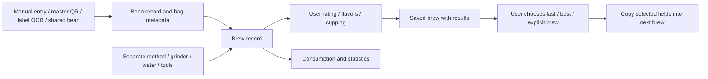

# Beanconqueror logic: beans, brewing, tasting and reuse

Research date: October 12, 2026. Decision: retain Coffee App's source-grounded recipes and guided tasting; borrow Beanconqueror's discipline around recorded context and repeatability. This is research and an implementation proposal, not production implementation approval.

## What the deeper investigation establishes

Beanconqueror 8.7.0 is primarily a configurable bean-and-brew journal with measurement tools. It connects a bean, preparation method, grinder and optional water/tools to a brew. The user records what happened, evaluates it, edits settings and repeats. Its ordinary brewing path does **not** contain a bean-to-recipe generator or a taste-to-next-recipe recommendation engine in the paths inspected.

That conclusion comes from tracing creation/defaults, explicit repeat, best-brew selection, tasting writes and their storage consumers, AI import, and measurement/control calculations. It is stronger than searching for the word “recommendation,” but does not establish that every line of every platform or private server has been audited.

The first inspection did not cover this depth. This report expands it to beans and pour-over as requested. The strongest newly discovered provenance is that the cupping model explicitly cites **Sweet Maria's spider graphs**. It is not a Hoffmann-authored brewing methodology.

## Evidence and reproducibility

- Inspected the official **v8.7.0 source tag**, commit `53c5426312d12ed825c9f3035990f30eef09baa8`, alongside the installed 8.7.0 Android app and its extracted JavaScript. [Source provenance and selected shipped-code matches](deep-source-provenance.json).
- Indexed 732 application TypeScript/template/JSON files for targeted searches. This is an index count, not a claim to have manually reviewed every file. Read the relevant models, creation/default/repeat paths, tasting saves, storage updates, consumers, import prompts, calculations and device-stop code.
- [17 executable probes](source-logic-probes.json) use methods extracted from the upstream TypeScript AST, with stubbed storage/UI. [Reproduction script](probe-source-logic.cjs). These are isolated behavioral checks, not the upstream test suite or an end-to-end device test. One harness setup error (missing timer stub) was fixed before the recorded passing run.
- The previous REA analysis parsed the shipped large JavaScript chunk but hit its semantic-graph node ceiling. This report does **not** recast that partial graph as complete. Source inspection supplies the readable traces; matching names/excerpts corroborate selected shipped paths, not reproducible-build equivalence for the whole source archive.
- Additional Android check: created a V60 method, long-pressed Add brew, chose V60 with no earlier V60 brew, and saw zero dose/temperature/time and no prescribed pours. Existing bean/grinder selections were available. [Method choice](deep-brew-method-choice.png), [new V60 form](deep-v60-empty-brew.png), [hierarchy](deep-v60-empty-brew.xml). Cancelled the draft; the existing single synthetic espresso record remained. [Readback](deep-v60-cancelled.xml).
- Upstream source is GPL-3.0. The recommendations below are independently expressed behavior and data concepts. No upstream implementation or assets were added to Coffee App production code.

## Where its coffee methodology comes from

| Area | What the evidence says | What it does not establish |
| --- | --- | --- |
| Overall product | The developer describes a brew as the combination of beans, preparation and grinder. Each can begin with minimal information. [Official concept](https://beanconqueror.com/blog/concept-and-terminology/). | A particular expert's recipe philosophy or an algorithm that knows the best settings for a bean. |
| Systematic tasting | `ICupping` explicitly links Sweet Maria's spider-graph article. Its categories and explanatory notes include SCAA/Cup of Excellence references. [Cupping model](https://github.com/graphefruit/Beanconqueror/blob/53c5426312d12ed825c9f3035990f30eef09baa8/src/interfaces/cupping/iCupping.ts#L1). [Sweet Maria's article](https://library.sweetmarias.com/sweet-marias-spider-graphs/). | Current SCA certification, an espresso-specific scoring protocol, or a valid conversion into our sensory-intensity scores. |
| Tasting score | Ten attribute values plus cupper's correction are added. The UI exposes 0–10 sliders in 0.1 increments. [Score calculation](https://github.com/graphefruit/Beanconqueror/blob/53c5426312d12ed825c9f3035990f30eef09baa8/src/components/cupping-radar/cupping-radar.component.ts#L111). | A statistical quality model, predicted flavor profile, or personalized preference model. Do not assume this sum is interchangeable with a standardized 100-point score. |
| Extraction chart | A fixed reference box: non-espresso extraction yield 19–24% and TDS 1.25–1.5%; espresso 18–22% and TDS 8–12%. [Chart code](https://github.com/graphefruit/Beanconqueror/blob/53c5426312d12ed825c9f3035990f30eef09baa8/src/app/brew/brew-popover-extraction/brew-popover-extraction.component.ts#L79). | The chart code does not cite a scientific source for those exact boundaries. They are implementation constants, not proof that every coffee outside the box is bad. |
| Bean aging | Dates are used for age calculations. Frozen time is discounted using `floor(frozen days / 90)`. [Age code](https://github.com/graphefruit/Beanconqueror/blob/53c5426312d12ed825c9f3035990f30eef09baa8/src/classes/bean/bean.ts#L246). | A validated freshness model, roast-dependent resting advice, or a scientific source for the 90:1 factor. No supporting citation was found in the inspected implementation. |
| Hoffmann | The website features a favorable mention by James Hoffmann. | Endorsement does not establish that he authored the app's recipes or logic. No named Hoffmann/Rao/Kasuya recipe engine was found in the inspected release. |

Coffee App currently has a different basis. [handbrew.js](../../../src/lib/handbrew.js) contains brewer-specific configuration, named technique families, bean research and recipe repair/validation. [tastingExpectations.js](../../../src/lib/tastingExpectations.js) derives expected profiles from origin/process/roast/altitude, and [tastingWizardSteps.js](../../../src/lib/tastingWizardSteps.js) saves guided answers and user scores. The local [tasting methodology brief](../2026-06-29-tasting-methodology-brief.md) attributes the sensory sequence to Hoffmann. These establish our implementation's stated basis; they do not independently validate every numerical heuristic in it.

**Implication:** keep our instructional approach. Beanconqueror adds useful ideas for evidence and memory; it does not supply a superior bean-specific recipe brain that we can simply transplant.

## The bean model and lifecycle



There is no discovered taste-diagnosis step between “saved results” and “next brew.” The user provides the judgment.

### Bean facts, label claims and personal experience

The [bean model](https://github.com/graphefruit/Beanconqueror/blob/53c5426312d12ed825c9f3035990f30eef09baa8/src/classes/bean/bean.ts#L21) stores name/roaster, dates, roast level/range, intended roast use, blend status, origins, label aromatics, weight/cost and optional supplied cupping points. Separately, it stores personal rating, cupping values and selected/custom flavors. Individual brews have their own rating and cupping too.

Two particularly useful distinctions:

1. **Roast level and intended use are separate.** “Espresso roast” is not automatically a measured darkness, and an espresso intention is not itself a recipe.
2. **Roaster notes are not what the user tasted.** Imported aromatics and supplied cupping points do not substitute for a personal brew's sensory observations.

Origin information is an array, including country, region, farm, farmer, variety, process, elevation and blend percentage. That supports blends without reducing them to one supposedly certain origin. The AI construction path uses structural cleanup such as multiple origin entries implying a blend; this is data normalization, not extraction advice. [Construction and validation](https://github.com/graphefruit/Beanconqueror/blob/53c5426312d12ed825c9f3035990f30eef09baa8/src/services/aiBeanImport/bean-construction.service.ts#L94).

**For us:** reuse the evidence separation already present in [recipeEvidence.js](../../../src/lib/recipeEvidence.js). A source's bean description, our expected profile, the user's observation and a suggested change should remain distinguishable in Ruphus's context. Do not add a large bean form merely because the competitor can store these fields.

### Import is not recipe generation

Manual entry accepts a minimal bean. Roaster QR import maps a server bean into the local model; user-shared beans use a separate sharing/import path. AI import uses OCR followed by structured field extraction. Its [cloud system instructions](https://github.com/graphefruit/Beanconqueror/blob/53c5426312d12ed825c9f3035990f30eef09baa8/src/data/ai-import/ai-cloud-prompt.ts#L4) require explicit label evidence and an unknown marker where information is absent. The requested output is coffee metadata, not dose/grind/pour instructions.

The app can transmit brew data for beans with a roaster QR identifier. The inspected [tracking service](https://github.com/graphefruit/Beanconqueror/blob/53c5426312d12ed825c9f3035990f30eef09baa8/src/services/brewTracking/brew-tracking.service.ts#L20) maps brew fields and fires the request without using a returned recipe. That is not evidence of a user-facing recommendation feedback loop. Private server analysis was not available. Aspirational analytics wording about future guidance also does not prove that guidance ships today.

### Inventory and bag state

For a bean, consumed weight is the sum of each brew's explicit `bean_weight_in` when positive, otherwise `grind_weight`. This distinguishes beans taken from the bag from grounds actually used in the brew. A known bag with at most 5 g remaining qualifies for an **archive question**; it is not automatically classified as undrinkable. [Consumption rule](https://github.com/graphefruit/Beanconqueror/blob/53c5426312d12ed825c9f3035990f30eef09baa8/src/services/uiBrewHelper.ts#L179).

Age ordinarily means elapsed days since roast. Frozen/unfrozen dates alter the displayed age using the 90:1 rule; an archived bean with brews stops counting at its latest brew. Brew-specific age uses the brew date. Freeze/unfreeze also has portion/bag workflows, but no freeze mutation was exercised in this research.

**For us:** opening or editing a recipe must not count as brewing or consume beans. Frozen status can be useful context later, but do not import their numerical age factor into our freshness recommendations. Bag/portion inventory is a separate product decision, outside the small espresso release.

## How brewing works, including pour-over

### Method presets describe equipment and fields

The [preparation model](https://github.com/graphefruit/Beanconqueror/blob/53c5426312d12ed825c9f3035990f30eef09baa8/src/classes/preparation/preparation.ts#L20) combines a named brewer, style category, configurable field visibility/order, default/repeat rules and optional tools/device connection. V60, Chemex and Kalita map to pour-over; AeroPress and French press map to full immersion. A generic espresso machine is supported alongside specific connected devices.

Selecting V60 does not install a timed pouring recipe. The new-method runtime check opened a blank brew with ordinary before/while/after sections. I found logging for bloom and elapsed time, plus optional scale/flow graphs, but no named expert recipe library or automatic roast/process-to-pour schedule in this release's inspected paths.

The [grinder model](https://github.com/graphefruit/Beanconqueror/blob/53c5426312d12ed825c9f3035990f30eef09baa8/src/classes/mill/mill.ts#L4) is independent: name, notes, optional timer/speed capability. Grind setting is a string on the brew. It does not provide a calibrated cross-grinder conversion model. A built-in grinder can be represented independently just like an external grinder; this is not Breville-specific.

### The exact source of a new brew's settings

The inspected initialization order is:

1. If an explicit brew template was supplied, load it using repeat-field rules.
2. Otherwise, if the user chose a particular preparation, find its latest brew and load eligible fields; if none exists, start an empty brew carrying that method.
3. Otherwise, if last-brew loading is enabled, load the latest brew using default-field rules.
4. Apply an explicit bean preset when the entry path supplied one.

[Initialization](https://github.com/graphefruit/Beanconqueror/blob/53c5426312d12ed825c9f3035990f30eef09baa8/src/components/brews/brew-brewing/brew-brewing.component.ts#L313), [field-copy rules](https://github.com/graphefruit/Beanconqueror/blob/53c5426312d12ed825c9f3035990f30eef09baa8/src/components/brews/brew-brewing/brew-brewing.component.ts#L1475).

Global flags govern which fields carry over, with preparation-specific overrides when enabled. The default last-brew path excludes rating/notes. **Explicit repeat defaults include rating/notes**, as does the separate fast-repeat helper. The method-specific override can suppress them. The probes demonstrated each case.

This means “suggested” values can simply be remembered values. It also means we should not blindly clone their repeat semantics. Our saved recipe should reopen its targets; a fresh tasting must start with empty observations.

### Best means user-selected

Marking a brew best clears other best flags for that bean. The bean action can then offer the latest eligible brew or the user-marked best brew. It filters archived bean/grinder/method references. It does not calculate a best recipe from ratings, flavor scores or extraction readings. [Manual best flag](https://github.com/graphefruit/Beanconqueror/blob/53c5426312d12ed825c9f3035990f30eef09baa8/src/components/brew-information/brew-information.component.ts#L431), [last/best selection](https://github.com/graphefruit/Beanconqueror/blob/53c5426312d12ed825c9f3035990f30eef09baa8/src/components/bean-information/bean-information.component.ts#L502).

**For us:** “keep this recipe” through editing/chat achieves the important part. Do not add a best-shot ranking system. Reuse must match bean and equipment, rather than inheriting settings from an unrelated latest brew.

### Calculations, not taste diagnosis

| Calculation | Actual implementation | Application to Coffee App |
| --- | --- | --- |
| Espresso ratio | Beverage output / ground dose; 18 g in, 36 g out → 1:2. | Essential for espresso recipe display/validation. |
| Pour-over ratio | Input water / ground dose; 20 g, 300 g → 1:15. | Preserve our existing input-water semantics; don't share an ambiguous “quantity” field. |
| Concentration notation | Dose × 1000 / selected quantity, displayed as g/L. | No need for an extra novice-facing metric. |
| Extraction yield | Beverage output × measured TDS / dose; full immersion can use input water instead. | Defer: without refractometer data we cannot infer this from time or taste. |
| Net beverage weight | Full vessel weight minus empty vessel weight. | Ruphus can explain tare/subtraction if asked; no extra calculator screen needed. |
| Cupping score | Sum of user-entered attribute values and correction. | Keep our existing sensory controls and personal rating; don't convert them to this score. |

[Brew arithmetic](https://github.com/graphefruit/Beanconqueror/blob/53c5426312d12ed825c9f3035990f30eef09baa8/src/classes/brew/brew.ts#L363), [vessel calculator](https://github.com/graphefruit/Beanconqueror/blob/53c5426312d12ed825c9f3035990f30eef09baa8/src/app/brew/brew-beverage-quantity-calculator/brew-beverage-quantity-calculator.component.ts#L60).

The ratio helper guards missing/zero dose; the extraction helper itself can produce `Infinity` for a zero dose, which the isolated probe demonstrates. That does not establish a reachable UI defect, but reinforces that any arithmetic we implement needs its own finite-number and unit validation. The ratio modal is a calculator display; its calling path does not apply an optimized recipe on dismissal.

### Tasting writes and what happens next

Cupping edits a cloned bean or brew and saves it back. Rating similarly updates a brew. Storage emits an update; inspected consumers invalidate caches and refresh views. Ratings feed sorting/filtering and summary statistics. Cupping values feed the radar display/export, not a rule that adjusts grind or yield. [Cupping save](https://github.com/graphefruit/Beanconqueror/blob/53c5426312d12ed825c9f3035990f30eef09baa8/src/app/brew/brew-cupping/brew-cupping.component.ts#L156), [rating save](https://github.com/graphefruit/Beanconqueror/blob/53c5426312d12ed825c9f3035990f30eef09baa8/src/app/brew/brew-rating/brew-rating.component.ts#L91), [storage update](https://github.com/graphefruit/Beanconqueror/blob/53c5426312d12ed825c9f3035990f30eef09baa8/src/classes/storageClass.ts#L111).

The controlled source probe changed the template's rating and note from a synthetic sour test to a bitter test; repeated dose, yield and grind stayed identical. This checks the repeat mechanism, not every possible app flow.

**For us:** there is no recovered taste-to-adjustment algorithm to import. Ruphus's reasoning remains our work: use the bean, source-grounded recipe, actual setup, saved tasting and any user-reported measurements; distinguish insufficient evidence from a useful single next change; persist only a requested update. Existing guided tastings already save notes, scores and `changeTomorrow`.

## Advanced automation that should not be confused with recipe intelligence

The app can overlay a previous/imported flow profile as a reference and record live weight/flow/pressure data. A user selects that reference; it is not a generated pouring recipe.

For supported connected espresso machines, `calculateBrewByWeight` estimates recent flow using linear regression over weight samples. It tests whether current weight plus predicted flow during sampling/residual lag will reach the user-set target, then connected-device code sends the stop action. Without predictive mode it compares current weight to target. This adapts **when to stop within the current shot**, not which recipe to recommend after tasting. [Implementation](https://github.com/graphefruit/Beanconqueror/blob/53c5426312d12ed825c9f3035990f30eef09baa8/src/components/brews/brew-brewing-graph/brew-brewing-graph.component.ts#L3112), [developer explanation](https://beanconqueror.com/blog/brew-by-weight/).

Water profiles, home-roast batch metadata and green-bean relationships are further context modules. Their presence does not imply an automatic water-chemistry or roasting recommendation engine. Hardware protocols, all freeze/roast mutation branches, backup security and private server behavior were not exhaustively audited or runtime-tested. None is required for Rob's recipe/chat/tasting flow.

## What to bring into our app

| Priority | Adaptation | Concrete implementation direction | Scope |
| --- | --- | --- | --- |
| Now | Remember settings in the correct context | Saved recipe keyed/validated against bean, method, machine, grinder and basket. Retain user edits and invalidate incompatible grinder guidance. | Existing espresso R1/R9. |
| Now | Separate recipe targets from results | Snapshot the recipe/setup on a tasting. Optional actual dose/yield/time only when the user reports them; missing remains unknown. | Existing espresso R4/R7; no measurement form. |
| Now | Preserve the user's successful adjustment | Ruphus can propose one change, save it when instructed and show the actual persisted change with Undo. Direct edits share validation. | Existing espresso R9. |
| Now | Treat imported claims as evidence, not observations | Keep roaster descriptors, app expectations and personal tasting separate in chat context. Preserve unknown fields and provenance. | Reuse existing evidence structure. |
| Later candidate | Apply the same recipe/tasting connection to pour-over | A V60 tasting should retain the recipe revision, technique and grinder used, so “last time” refers to a real cup. | Audit current coverage before adding work. |
| Later candidate | Restore a successful earlier recipe from a tasting | Chat finds the relevant saved snapshot, explains differences and applies a requested revision using the same edit action. | No new journal or ranking UI. |
| Later candidate | Richer bean context when relevant | Roast intention, blends, roast/open/frozen dates can improve questions and explanations without requiring a longer onboarding form. | Separate backlog; no automatic 90:1 freshness rule. |
| Defer | Instrumentation and management suite | Scale/pressure integrations, predictive stop, TDS charts, water minerals, green-bean roasting and freezer portions. | Outside the intended experience. |

Suggested minimal context shape, an independent proposal rather than recovered competitor code:

```text
saved recipe: bean + equipment + revision + targets + source evidence
tasting: recipe snapshot + user's sensory answers + optional reported actuals
chat: those records + current question
requested edit: validated patch + expected revision -> saved receipt / failure
```

A tasting save alone does not rewrite the recipe. A recipe edit alone does not establish that anyone brewed or liked it. A new grinder does not inherit the old grinder's dial number. These apply equally to espresso and pour-over.

## Filtru: useful comparison, different evidence depth

Filtru's current public guides do contain baseline step recipes and advertise community alternatives. Its [V60 page](https://getfiltru.com/brew-guides/hario-v60/) gives a 13 g / 220 g, 94°C baseline with timed stages, labeled as its own baseline without a named expert attribution on that page. Its [journal description](https://getfiltru.com/coffee-journal-app/) connects recipes and timing to saved notes and adjustments. Those support borrowing clear step structure and retaining brew context; they do not establish that Filtru has a better scientifically grounded recipe or reveal its proprietary recommendation rules.

We already have timed pour-over recipes. The promising incremental idea is connecting the recipe actually used to the saved tasting and future chat, rather than copying another baseline or adding a second timer. The current Filtru Android acquisition failed at its official listing, as documented in [the initial report](README.md#filtru-acquisition-boundary). No current Filtru binary or recommendation engine was inspected. Comparable private-logic conclusions remain unavailable.

## Decision and remaining proof

Keep our Hoffmann/source-informed recipe and tasting foundation. Use Beanconqueror's bean/brew separation, contextual reuse and honest measurement semantics to improve continuity. Do not present their cupping scores, chart boxes or frozen-age factor as scientifically validated rules for our users.

The espresso plan remains small and still needs its revised mockup reviewed before production work. Broader pour-over ideas above are research recommendations, not automatically added implementation requirements. Further high-value research would require an obtainable current Filtru installation and targeted testing of its review-to-recommendation flow; reading its marketing cannot substitute for that evidence.

Research closeout: the emulator started for this pass was stopped. The V60 method and original synthetic espresso fixture remain for reproducibility; no V60 brew or new tasting was saved. Decisive screenshots, source probes and the pinned source are retained. Redundant download/navigation captures were removed. The pre-existing mockup preview was left available.
